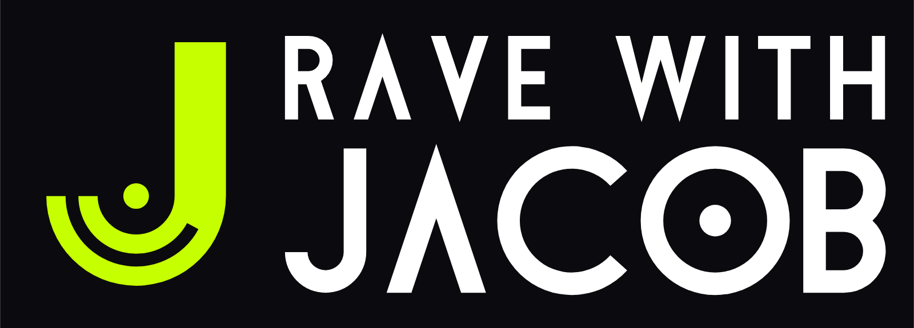

# Rave with Jacob — Logo Guidelines

## 1. The logo
- **Idea:** the Vinyl J. The curve of the J is half a spinning record, with one groove and the centre hole.
- **Versions:** horizontal (primary) · stacked · symbol only · name only.
- **Wordmark:** custom-drawn letters. The A is an open Λ and the O is a speaker cone. Never retype the name in a font;
  always use the files.

| File | Use |
|---|---|
| `master/lockup-horizontal.svg` | Primary logo on light backgrounds |
| `master/lockup-horizontal-on-dark.svg` | Primary colour logo, with its own black panel |
| `master/lockup-horizontal-transparent-dark-bg.svg` | Colour logo for placing on your own dark background |
| `master/lockup-stacked*.svg` | Square-ish spaces: posters, flyers, merch, signage |
| `master/symbol.svg` | The J alone (avatars, stamps, merch) |
| `master/symbol-small.svg` | The J for 32 px and below (groove removed) |
| `master/wordmark.svg` | The name without the J |
| `variants/` | Black, white and acid-green versions, square/app-icon versions and PNGs |
| `variants/favicon.*`, `icon-*.png`, `apple-touch-icon.png`, `site.webmanifest`, `head-snippet.html` | Website icon set |
| `png/` | Colour lockups as PNG for quick sharing |
| `presentation.html`, `board/` | Presentation board with event mockups |

## 2. Clear space
Keep a clear zone around the logo at least as wide as **the J's stem** on all sides. That's the vertical bar of the J,
about 1/6 of the symbol's height. The zone scales with the logo.

## 3. Minimum size
| Version | Screen | Print |
|---|---|---|
| Horizontal | 140 px wide | 35 mm wide |
| Stacked | 90 px wide | 22 mm wide |
| Symbol | 16 px (use `symbol-small.svg` / the favicon files below 32 px) | 6 mm |

## 4. Colour
| Name | HEX | RGB | CMYK (approx.) | Pantone (closest) |
|---|---|---|---|---|
| Acid | `#C6FF00` | 198 · 255 · 0 | 22 · 0 · 100 · 0 | 389 C |
| Night | `#0B0B0F` | 11 · 11 · 15 | 75 · 68 · 67 · 90 (rich black) | Black 6 C |
| White | `#FFFFFF` | 255 · 255 · 255 | 0 · 0 · 0 · 0 | — |

Acid green is a screen colour, so it will print duller. Check a printed proof or a Pantone swatch before a print run.
For a true neon on posters, ask your printer for a fluorescent spot ink.

**Approved logo and background pairs:**
- **Acid J + white name on Night.** This is the primary pairing.
- **Night on white or light backgrounds.** Use Night for the whole logo.
- **All white on Night or on dark photos.**
- **All acid on Night.** Use for merch and stickers.
- **Night on Acid.** Use for wristbands and posters.

**Never put acid green on white.** At about 1.1:1 contrast it's unreadable.

## 5. Typography
- The logo uses its own custom letters.
- For flyers and the website, use **Jost** (SIL Open Font Licence, free for commercial use). Set headlines in
  uppercase Medium with wide tracking (+10–15 %), and body text in Regular.
- Web fallback: `Jost, "Futura", "Century Gothic", system-ui, sans-serif`.

## 6. Don'ts
- Don't stretch, squash, rotate or outline the logo.
- Don't add glows, gradients or shadows. The flat acid green is the "neon".
- Don't recolour the logo outside the palette, or put acid green on light backgrounds.
- Don't rearrange the lockup or change the size of RAVE WITH relative to JACOB.
- Don't use the grooved J below 32 px. Use the small cut instead.
- Don't place the logo on a busy photo without a Night panel behind it.

## 7. Notes
- **Trademark:** no trademark search has been done. Run a search before registering the name or printing at scale.
- **Source:** all artwork is built from paths with no font files or embedded images, so the files can be scaled to any
  size.
